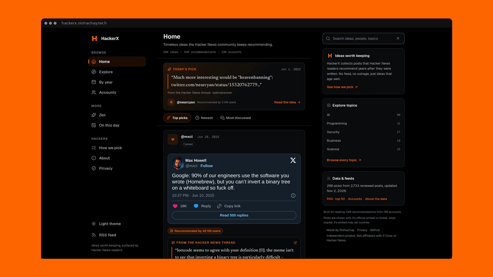

<p align="center">
  
</p>

<h1 align="center">HackerX</h1>

<p align="center">
  <b>X posts that Hacker News readers keep recommending, years later.</b><br>
  <a href="https://hackerx.nishachay.tech">hackerx.nishachay.tech</a>
</p>


<p align="center">
  <a href="https://hackerx.nishachay.tech"></a>
</p>


<p align="center">
  <b>266</b> picks &nbsp;·&nbsp; <b>2,733</b> posts scored &nbsp;·&nbsp; <b>1,285</b> HN comments &nbsp;·&nbsp; <b>549</b> recommenders &nbsp;·&nbsp; <b>196</b> accounts &nbsp;·&nbsp; <b>17</b> years
</p>

---

## What it is

People on Hacker News link to X posts all the time. Most of those links are about the news of the day. A few keep coming back, cited by different readers, in different threads, years apart.

HackerX finds those few. It reads every HN story and comment that links to an X post, keeps the posts that several HN readers cited and at least one recommended, and drops anything that only mattered that week.

There are no accounts, votes, or submissions. It's a read-only archive.

## What you get

- **266 picks** across 19 topics, led by AI, programming and security
- **The HN comments that recommend each post**, quoted word for word and linked to their threads
- **Browse** by topic, year and account
- **Save and history** kept in your browser, with export and import
- **Keyboard shortcuts**, light and dark themes, and an RSS feed

## How a pick is made

1. **Pull.** Every HN story and comment that links to `x.com` or `twitter.com`.
2. **Merge.** Keep posts cited by **3+ different HN authors**.
3. **Judge.** A decision model checks each post: is it evergreen (**30%+ average**), and do the commenters recommend it, cite it neutrally, or disagree?
4. **Publish.** Keep posts with **1+ recommending author**, ranked by recommenders, other citers, story points, recency and year spread.

Thresholds live in `config.json`. The site's [How we pick](https://hackerx.nishachay.tech/how-we-pick/) page reads the same file.

## What's stored, and what isn't

Posts are shown only through X's official embed, after the visitor allows it, or as plain links. Post text, media, engagement counts, display names and avatars are never published. The archive keeps only our own metadata (handle, date, topic, rank) and the HN comments that recommend each post.

- [Privacy](https://hackerx.nishachay.tech/privacy/): what the site keeps in your browser and how X's embed works
- [Request removal](https://github.com/nishachay/hackerx/issues/new?template=removal.yml): we aim to act within 24 hours

## Run it locally

```sh
npm install
npm run dev
```

`npm run build` writes a static export to `out/`. Without `data/site/`, the UI falls back to a small preview set, so a fresh checkout still renders.

## Pipeline

A Python pipeline in `pipeline/` refreshes the archive:

| Step | Script |
|---|---|
| Pull HN | `pull_hn.py` |
| Extract and merge | `extract_tweets.py`, `merge_tweets.py` |
| Fetch posts | `fetch_tweets.py` |
| Judge | `filter_tweets.py` |
| Rank and publish | `build_site.py` → `data/site/` |

Every published card is schema-checked against a public field whitelist.

## Deploy

Static Next.js export on Cloudflare Workers Static Assets (`wrangler.jsonc`). Workers Builds deploys every push to `main` with `npm run build` and `npx wrangler deploy`. Set `NEXT_PUBLIC_SITE_URL=https://hackerx.nishachay.tech`.

## Tests

```sh
npm test
```

This runs the Python unit tests, link and RSS checks on the built site, and Playwright browser tests. Every X request is stubbed, so nothing contacts X.

## Credits

Inspired by Andrej Karpathy's [HackerTube](https://hackertube.org). Data comes from public Hacker News comments through the Algolia HN API. No tracking scripts.

Made by [nishachay.tech](https://nishachay.tech)
